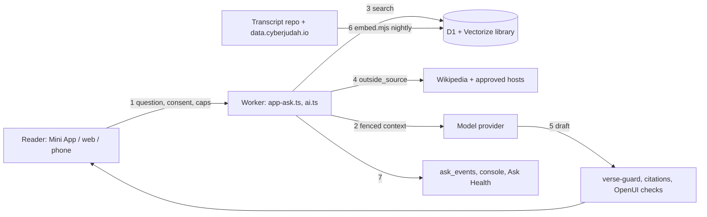

# Ask threat model (STRIDE + OWASP LLM Top 10)

MDLC work package 4, stage 1 ("Plan and threat-model"). Checked against `main` at d6a915b9 on 2026-11-10. This is a register: each threat names the control that exists today (with the file that enforces it) or says it is a gap. It adds no answer rules and no teaching; the answer rules are in `docs/ASK-POLICY.md` (WP5) and the system prompt.

"Ask" here is the whole answering path: `/api/ask` and `/api/app/ask*` (Mini App, web and phone), `GET /api/search/answer`, the voice routes, the agent and its tools, retrieval over D1 and Vectorize, the answer cache and the billing around them. The MCP server (`/mcp`) is in scope only where it shares the library readers; it calls no model.

Companion designs: [ASK-PII-SCAN.md](ASK-PII-SCAN.md) (transcripts before indexing) and [ASK-ALERTS.md](ASK-ALERTS.md) (thresholds and Worker error tracking).

## Assets

| Asset | Why it matters |
|---|---|
| Faithfulness of answers to the classes and the KJV | The product promise. A wrong attribution or invented doctrine is the most serious harm here. |
| Readers' words and records: questions, chat history, saved chats, reminder settings, IP address, Telegram/Firebase identity | Personal data under `docs/PRIVACY.md` and the published policies. |
| Money: the Ask balance, Stars, the free daily budget, provider accounts (Claude, Unified Billing) | Cost abuse and billing errors are direct loss. |
| The library and its indexes: D1 `search_docs`, `teaching_passages`, Vectorize `cyberjudah-teachings`, transcripts in `DevSecObie/cyberjudah`, `data.cyberjudah.io` | Poisoned or stale content becomes "evidence". |
| Model and prompt configuration: `shared/ask-models.json`, `wrangler.jsonc` model vars, prompts in `bot/src/ai.mjs`, `APP_STUDY_RELEASE` | A silent change here changes every answer. |
| Secrets: provider keys, `PRIVACY_KEY`, bot token, `MCP_KEY`, Cloudflare API token | Compromise of any one widens every threat below. |

## Trust boundaries

1. Reader → Worker (Telegram launch data, Firebase token, browser session).
2. Worker → model provider (Workers AI, AI Gateway → Anthropic and the Unified Billing providers).
3. Library content → model context (retrieved passages, transcripts, OCR'd books, tool results).
4. Outside web → model context (`outside_source`: Wikipedia and the approved hosts).
5. Model output → reader (answer text, citations, OpenUI cards, proposed reminder changes).
6. Build inputs → production (Cloudflare's model catalog, transcript repo, npm, GitHub Actions).
7. Worker → logs and admin views (`console`, `ask_events`, Ask Health, `tellAdmins`).

## Data flow

## Threats

Status: **control** = in place on `main`; **partial** = in place but with a named hole; **gap** = nothing yet. "WP" points to the MDLC work package that closes it.

### Prompt injection (OWASP LLM01; STRIDE: Tampering, Elevation of privilege)

| # | Threat | Control today | Status |
|---|---|---|---|
| T1 | Instructions planted in a library record, transcript or class note ("ignore previous instructions", forged roles, forged `source_n`) steer the answer. | `grounding.mjs` fences every source and tool result as labelled JSON, escapes role tags, fences and BEGIN/END markers; a fixed system instruction says it is data; only host-assigned `source_n`/`source_registry` register citations. Tests plant role tags, a forged model, a forged money tool and a forged citation (`docs/ASK-GROUNDING.md`). | control (defence in depth, not immunity) |
| T2 | Same, through an outside page fetched by `outside_source` (an approved host can still carry hostile text, e.g. a wiki edit). | Same fencing; host allowlist (`source-policy.ts`, `data/ask-sources.json`, KV `ask:sources` only newer revisions, set from the CMS); `https:` only on the first URL; the final host after redirects must be approved (`ask-tools.ts`). | partial: see G3 |
| T3 | Same, through PDFs. | Reader-uploaded PDFs never reach a model: `uploaded-pdf.ts` checks and relays the file to the reader's own chat and keeps nothing. Library book scans reach the model only as OCR text through the fenced tool path. | control. Any future "ask about this PDF" must go through the same fence and get its own red-team cases (WP3). |
| T4 | Injection makes the model leak the reader's private tool results (saved chat titles, reminder settings) to a third party by putting them in an `outside_source` URL or search query. | All tools, including `my_saved_chats` and `my_reminder`, are offered in one agent run (`agent.ts`). `outside_source` takes a model-chosen URL of up to 400 characters, query string included, on any approved host, and a 120-character Wikipedia search. | **gap G1** |
| T5 | Injection proposes a harmful account change. | `propose_reminder_change` only proposes; nothing changes until the reader taps Confirm. No purchase, payment, message-sending or deletion tool exists. | control |
| T6 | Injection or a jailbreak in the question itself bypasses the answer rules ("answer from your own knowledge", doctrine bait). | System prompt rules; coverage gate (shadow); verse-guard replaces misquoted KJV; citation registry. No red-team set measures it. | partial: gap G6 (WP3 red-team) |

### Sensitive information disclosure (LLM02, LLM07; STRIDE: Information disclosure)

| # | Threat | Control today | Status |
|---|---|---|---|
| T7 | Questions, answers or identities end up in logs. | Invocation logs off (`wrangler.jsonc`), so `?q=` URLs are not logged; AI Gateway payload logging off (`cf-aig-collect-log-payload: false`, `collectLog: false`); `ask_events` hold no question, answer or reader. | partial: see G2 |
| T8 | Raw provider or exception messages, which can quote the request (validation and content-filter errors often do), are stored and shown. | `ask_events.detail` takes `error.message` (up to 200 characters) in `app-ask.ts` and `ai.ts`; the same text goes to `console.error` (`ask_failed`, `app_agent_failed`, `search_answer_failed`, `ask_stream_failed`); `mcp.ts` logs the full error. Ask Health shows `detail` to admins. | **gap G2** |
| T9 | Personal data spoken in class recordings (a caller's phone number, an email address read out) is indexed and quoted back in answers. | None. `embed.mjs` embeds every transcript chunk and stores its text in Vectorize metadata. | **gap G4**, design in [ASK-PII-SCAN.md](ASK-PII-SCAN.md) |
| T10 | Provider receives more than needed. | Consent per provider (428), only the question, earlier questions in the chat and library passages; never name or Telegram ID (`docs/PRIVACY.md`). | control |
| T11 | Answer cache serves one reader's private data to another. | Only first questions without history are kept, keyed by release, mode, model and a hash of the normalised question (`answer-cache.ts`), and only with library sources (`ai.ts` `keepAnswer` calls). Nothing excludes an answer whose agent run called `my_saved_chats` or `my_reminder`: a first question that mixes a library question with "my saved chats" / "my reminder" can be kept for 7 days and served to the next reader who asks the same words with the same model. | **gap G7** (found in this review; fix below) |
| T12 | System prompt extraction. | Prompts are in the public repo; nothing secret is in them. | accepted |

### Supply chain and model swaps (LLM03, LLM04; STRIDE: Tampering, Spoofing)

| # | Threat | Control today | Status |
|---|---|---|---|
| T13 | A new or changed model in Cloudflare's catalog reaches readers untested (`ask-models.mjs` regenerates the 96-model list). | Generated file is reviewed as a PR; prices required. No evaluation gate. | **gap**: WP2 allowlist (shadow first) + WP3 per-model matrix |
| T14 | A provider alias (`claude-*` without a date, `@cf/...` alias) silently changes the weights behind it. | None; answers are not stamped with the resolved model version. | **gap**: WP1 version stamps; WP3 re-runs the suite on a schedule |
| T15 | Poisoned or wrong transcripts/notes (bad captions, a malicious commit to the transcript repo) become evidence. | Transcripts come from `DevSecObie/cyberjudah` `main` (branch protection there); class corrections feed; encyclopedia import is SHA-256-checked. No integrity check on transcript files and no corpus release id. | partial: WP1 corpus release id; G4 scan reports changes per video |
| T16 | A compromised npm dependency or Action runs in the Worker or deploy. | Lockfile, weekly `security.yml`, Dependabot; deploy needs owner Approve. | control (outside the LLM scope; tracked by the Security Engineer) |
| T17 | Stale index: the index lags the library (the stale-notes problem of 2026-11-09). | Nightly embed; `/api/health` vector count. No freshness comparison. | **gap**: WP1 corpus id + alert A6 in [ASK-ALERTS.md](ASK-ALERTS.md) |

### Output handling and agency (LLM05, LLM06; STRIDE: Tampering, Elevation)

| # | Threat | Control today | Status |
|---|---|---|---|
| T18 | Model output rendered as active content (script, links to arbitrary sites). | Static OpenUI validation on server and client, no state/query/mutation nodes; citation URLs come from the server registry (`retrieved-source-url.ts` limits hosts); client caps stream sizes. | control |
| T19 | Fabricated Scripture or misattributed teaching. | `verse-guard` corrects KJV quotes; citation membership checks; `unsupported_refs`; honest-gap wording; coverage gate (shadow). Faithfulness of paraphrase is not checked. | partial: human/owner review (MDLC stage 4), golden answers are the owner's |
| T20 | Tools do more than read. | Agent tools read public data or the reader's own records; the only write is the confirmed reminder change. MCP is read-only and keyed (`MCP_KEY`/owner OAuth). Worker credentials are broader than the tools (pipeline doc stage 6). | control, with the noted residual |

### Misinformation and over-reliance (LLM09)

| # | Threat | Control today | Status |
|---|---|---|---|
| T21 | Readers treat a model paraphrase as the teaching. | Answers cite and link the class moment; "complementary to the teachers" rule; reader "wrong"/"harmful" report drops the cached answer. | partial: weekly review turns reports into eval cases (WP3/WP5) |
| T22 | Thin evidence answered anyway. | Coverage gate exists but `ASK_COVERAGE_MODE` is unset (shadow). | partial: owner decision to enforce after calibration |

### Vector store (LLM08)

| # | Threat | Control today | Status |
|---|---|---|---|
| T23 | Private records retrieved into answers. | The index holds only public library and transcripts; private notes, studies and chats are not indexed (pipeline doc stage 5). | control |
| T24 | Embedding collisions or keyword stuffing rank a hostile chunk first. | Hybrid retrieval and reranking; keyword placeholder scores never count as vector provenance. | partial: covered by red-team retrieval cases (WP3) |

### Unbounded consumption (LLM10; STRIDE: Denial of service)

| # | Threat | Control today | Status |
|---|---|---|---|
| T25 | One reader or script drains the free daily budget. | Per-account daily caps, per-IP caps on a keyed hash (`client-ip.ts`), free-spend reservation before inference (`free_spend_holds`), `ASK_FREE_DAILY_USD_CAP` (default 0.11), 4,000-character question, 32k body. | control |
| T26 | A paid answer runs past what the reader authorised. | Model-specific `caps` and 409 confirmation, balance holds, `spend.ts` stops research inside the hold, settlement after inference, replay protection (`request`). | control |
| T27 | Provider account runs dry, or a pricing error charges wrongly. | Claude funds alert (`alert:claude_funds`), financial-integrity tests. No daily cost alert across all spend. | partial: alert A4 |
| T28 | Outside-source fetch reads a huge body. | 8-second timeout; text sliced to 1.5 MB after `r.text()` has read it all. | minor: read with a byte cap (G3) |
| T29 | Kill switch. | `ASK_APP_ENABLED=off` stops new inference, keeps reading and history; `rollback.yml`. | control |

### Spoofing and repudiation (STRIDE: S, R)

| # | Threat | Control today | Status |
|---|---|---|---|
| T30 | Forged identity to use another reader's balance or chats. | `initdata.mjs` checks Telegram launch data; Firebase token verified; browser sessions keyed-hashed; per-record sealing (`privacy.mjs`). | control |
| T31 | Can't tell later which model, prompt and corpus produced a reported answer. | Trace id links a report to its `ask_events` row; `model` is recorded. Prompt and corpus versions are not. | **gap**: WP1 |

## Gaps for this work package and who closes them

| Gap | Fix (design) | Owner |
|---|---|---|
| G1 private tool data can be put in an outside URL | In one agent run, once `my_saved_chats` or `my_reminder` has returned, refuse `outside_source` (or drop query strings and fragments from model-supplied URLs and allow only the search box path). Add an injection test that plants a "fetch archive.org/?q=<chats>" instruction. | t1x proposes; Devin/obie-39 implement in the agent (AI code is theirs) |
| G2 raw error messages in `ask_events.detail` and logs | Replace free text with a fixed error code from a classifier (`timeout`, `provider-4xx`, `provider-5xx`, `rate-limited`, `aborted`, `budget`, `ui-rejected`, `unknown`); never store `error.message`. Design in [ASK-ALERTS.md](ASK-ALERTS.md) §Worker error tracking. | t1x (privacy helper + tests) |
| G3 outside fetch: no protocol check after redirects; whole body read | Require `https:` on the final URL; read the body through a byte-capped reader (1.5 MB) instead of `r.text()`. | Devin/obie-39 (small, in `ask-tools.ts`) |
| G4 PII in transcripts | [ASK-PII-SCAN.md](ASK-PII-SCAN.md): report-only scan in `embed.mjs` first; masking only on the owner's word. | t1x |
| G5 no alerting | [ASK-ALERTS.md](ASK-ALERTS.md): thresholds computed from `ask_events` and spend tables, shown in Ask Health first (shadow), paging only when the owner turns it on. | t1x design; implementation by whoever owns `ask-health.ts` |
| G7 answers using the reader's own records can be cached for everyone | Never call `keepAnswer` when the run used any tool in `appTools` (`agent.ts`): return a `personal: true` flag from the run and skip the cache. Test: a scripted provider calls `my_saved_chats` on a first question with library sources; the cache must stay empty. Until fixed, the reach is small (exact same words, same model, within 7 days) but it crosses readers. | t1x flags now; fix in the agent (Devin/obie-39), one-line change plus test |
| G6 no red-team set | Behaviour-only cases for T1–T6, T11, T24 (planted instructions, exfil URL, doctrine bait asking for an answer "from memory", forged citations). No doctrinal wording in the cases. | WP3 (Codex t20); t1x supplies the security cases |

## How this stays current

Any change to prompts, tools, routing, the allowlist, the outside-source list or the indexing pipeline updates the matching row here in the same PR. A new tool adds a row under "Output handling and agency". Reviewed at each MDLC release gate (`docs/ASK-POLICY.md`).

References: [OWASP Top 10 for LLM Applications 2025](https://genai.owasp.org/llm-top-10/), [OWASP RAG Security Cheat Sheet](https://cheatsheetseries.owasp.org/cheatsheets/RAG_Security_Cheat_Sheet.html), Microsoft STRIDE.
