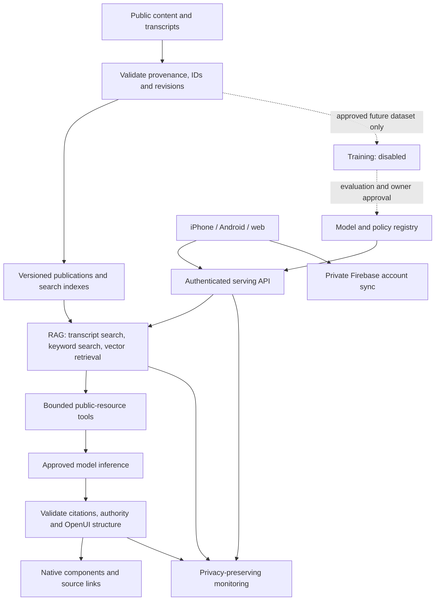

# CyberJudah AI pipeline and control register

Updated 2026-10-30. Scope: standalone Firebase-authenticated Ask on native and web. Telegram account linking remains parked. Public production and store publishing are outside this change.

## Operating rule

Ask is complementary to the teachers. Recorded transcripts are primary evidence of what was said; published class notes explain that teaching. KJV, people, encyclopedia, dictionaries, Nave, chronology and other reference works provide supporting context. They cannot establish a new doctrine, overrule a teacher, or fill a doctrinal gap from model memory. When retrieved teaching does not establish the answer, say so and offer the original sources.

Citation validation establishes provenance, not that a paraphrase faithfully represents a teacher. Human review of representative answers remains a release requirement. Prompt instructions and RAG alone do not eliminate injection or hallucination risks; use enforced boundaries as well. [OWASP prompt injection guidance](https://genai.owasp.org/llmrisk/llm01-prompt-injection/)

## Two paths, not one linear chain

RAG supplies evidence before the final model call. The planner may run first to select additional public resources; it receives no credentials or private-data tool. Training is a separate build-time activity, not something a user's question triggers.

## Stage-by-stage register

Status legend: **existing** = present in the repository, not proof of production configuration; **new** = implemented on this branch, pending deployment verification; **required** = not implemented or not yet verified.

| Stage | Assets | Trust boundary | Likely failures | Controls and present status |
|---|---|---|---|---|
| **1. Data** | Class/captain/history transcripts, caption timestamps, class notes, KJV, public people/encyclopedia/timeline/library records, Bible Strong dictionary and Nave, the Jewish Encyclopedia, source images, publication hashes. Private notes, studies and chats are separate account assets. | Authors, caption generation and imported reference works → reviewed publication; public CDN/repositories → Worker; device cache → app. Imported text is data, never privileged instructions. | Incorrect captions, changed article IDs, poisoned content, stale editions, missing attribution, reference material mislabelled as teaching, accidental inclusion of private records. | Existing: source paths and typed public APIs. New: separate teaching/scripture/reference evidence, hash-verified encyclopedia import preserving IDs and full text, versioned publication activation. Required: owner/editor approval and correction workflow for transcript meaning, publication freshness/coverage checks across the complete library. |
| **2. Training** | Potential approved training/evaluation datasets, labels, provenance, checkpoints and run manifests. **No CyberJudah fine-tuning job or custom weights are created by this setup.** | Reviewed public data → isolated training job/provider; dataset access → model artifact. | Memorized private data, training-data poisoning, unsupported doctrine reinforced in weights, evaluation leakage, cost runaway, inability to trace or revoke an artifact. | New serving policy explicitly records training disabled; the request path has no training tool. Required before enabling: permission/licence review, immutable dataset manifest, separate train/validation/test sets, no account data by default, budget, isolated credentials, teacher-reviewed acceptance set, signed/hashed artifacts and explicit owner promotion. No paid training or embedding rebuild is run by this change. |
| **3. Model registry** | Existing `shared/ask-models.mjs`; new `app-study-release.ts`: release/policy ID, approved serving IDs, UI contract, tool limits, training and purchase-tool status. | Reviewed code/config → serving deployment; provider model identifier → actual provider-managed model. | Unreviewed model substitution, incorrect price/capability metadata, mutable provider alias changing behavior, staging config reaching production. | Existing: catalog model lookup and configured free-model intersection. New: native allowlist requires explicit code promotion and policy ID in outcome telemetry. Current approved ID: `@cf/meta/llama-3.1-8b-instruct-fp8`. Required: recorded semantic evaluations per model revision and canary promotion; provider weights are not under our control, so this is a serving registry, not a claim to own immutable model checkpoints. |
| **4. Inference / serving** | Firebase identity, consent, bounded question/history, model request, daily allowance, streaming response and accounting. | Untrusted client → Firebase token verification → Worker; Worker → approved AI provider; provider output → validator → client. | Forged identity, caller-selected paid model, unexpected provider disclosure, exhausted budget, stalled streams, incomplete accounting after disconnect, unsafe output rendered as code. | Existing/new: verified Firebase account, pseudonymous quota keys, consent before inference, model allowlist, 32k request-body limit, 4k question limit, daily/IP caps and reserved budget, streamed heartbeat, final accounting after inference, bounded static OpenUI validation on server and client. New `ASK_APP_ENABLED=off` stops new Ask inference while reading and saved chats remain usable. Native purchases remain disabled. Required: live provider timeout/latency and recovery validation on staging. |
| **5. RAG / vector DB** | `cyberjudah-teachings` Vectorize index, D1 `search_docs`, D1 `teaching_passages`/`teaching_refs`, transcript files, versioned `app_reference_*` encyclopedia tables, source metadata. | Published content → indexes; read-only retrieval code → source evidence; public evidence → model context. | Missing transcripts, stale embeddings, false retrieval matches, snippets losing context, wrong timestamp, source mixing, unauthorized tenant retrieval, poisoned retrieval text. | Existing: hybrid semantic/keyword retrieval and reranking, transcript chunk metadata, source corrections. New: dedicated transcript search plus surrounding captions, stable citation IDs, actual article IDs, capped evidence, bounded search time, reference-only encyclopedia classification. No private notes enter this index. Required: measure coverage and staleness of all transcript feeds and vector records; reranking does not guarantee relevance. Staging shares the published teaching/vector resources and does not rebuild them. |
| **6. Agents / tools** | Public-resource planner, schema, typed read adapters, OpenUI library, native source navigation. | Model-produced resource/query → allowlisted tool; tool output → untrusted evidence; model-produced UI → validated native component. | Arbitrary URL fetching, SQL/action injection, prompt injection, reference-to-teacher citation laundering, fabricated verse text, private notes read without permission, purchases or mutations. | New: bounded enum of public resources, max four supplementary searches, no model-provided URLs/SQL, parameterized queries, max 24 evidence sources/12 displayed sources, no state/query/mutation OpenUI nodes, same allowlist on device, citation/evidence checks, KJV fetched through the app resource port. Navigation to private notes/studies is user-initiated only; their contents are not sent to Ask. Required: adversarial semantic evaluation and full device navigation review. Worker credentials remain broader than the read adapters; a compromised Worker is a separate boundary, not solved by the model tool allowlist. |
| **7. Monitoring** | Worker usage/timing events, `app_study_result`, resource-unavailable counters, anonymous answer-report aggregates, existing D1/vector health probes and native crash signals. | Runtime data → logs, reports and operations access; alerting → operator decisions. | Questions/answers in logs, broken indexes reported as “no results,” unknown failure rates, doctrinal drift missed by uptime checks, cost anomalies, alert fatigue. | Existing: quota/accounting and health checks. New: model/policy ID, outcome, elapsed time, teaching/transcript/reference/scripture counts; no question, answer, UID or source excerpt in these new events. Required: configure dashboard/alerts for UI rejection, missing teaching, resource failure, latency, budget exhaustion and stale indexes; review selected answers only with explicit sharing. Existing Telegram health paging is not changed or invoked by this task. |

## Public data coverage and deployment boundaries

- The server can query recorded teachings/transcripts, KJV, people, timeline, original dictionary and Nave, public notes, topics, law, precepts, case studies, glossary, published doctrine discussions and Strong definitions. These are relevant-resource searches, not dumping the whole library into each prompt.
- The Jewish Encyclopedia is indexed from the same checked publication used by the device. The build verifies archive and content SHA-256 values, keeps all 14,391 article IDs, retains full HTML and plain text, and activates a revision after import. This adds online reading plus server search; Offline copies remain supported.
- Bible Strong dictionary and Nave still use the existing public upstream gateway. They have not been copied into a new locally owned dataset. Upstream outages remain distinguishable from absent entries.
- The new encyclopedia tables are separate from account and billing tables. The staging workflow imports into `cyberjudah-telegram-staging` only. It does not update the shared teaching/vector corpus or production account data.
- The phone-supplied encyclopedia-excerpt workaround was removed. The server retrieves public evidence itself, so results do not depend on installed Offline copies.
- Personal notes, highlights, bookmarks, studies and chat sync remain private Firebase data. Public library search does not search those accounts. Anonymous local content may remain on-device until adopted by an account under the existing sync rules.

## Release gates and operator response

1. Automated: type checks; native rendering/navigation tests; authentication/consent/model rejection tests; malicious OpenUI and reference-authority tests; dictionary hash mismatch, import replay, long-article parity, pagination and exact article navigation; build/export verification.
2. Content: test scripture explanation, people, historical date, lexical definition and ambiguous doctrine questions. Every substantive teaching explanation must be supported by its displayed transcript/notes. A reference-only answer must not invent doctrine. An unclear caption must remain qualified. Owner/teacher review is required before calling semantic fidelity verified.
3. Device: confirm custom progress sentences and actual transcript searches, thumbnails, transcript timestamp links, Related scriptures, existing reader navigation, saved-chat reload and larger text on iPhone. No translation-comparison or second-Bible-version claims.
4. Operations: verify stage publication and `/api/health`; distinguish provider refusal, quota exhaustion, no results, missing publication and local network restrictions. Do not claim “all data covered” from a health check alone.
5. Stop/rollback: set `ASK_APP_ENABLED=off` for an inference incident; retain reading/history. Roll back the Worker to the previous verified deployment for a code issue. Restore the previous `app_reference_publications.revision` only after verifying its rows remain present. Reject corrupt incoming publications before activation. Do not delete user records to recover an AI issue.

Proposed alert thresholds, **not yet configured**: UI rejection above 5% over 20 completed requests; any repeatedly unavailable mandatory transcript/reference source; p95 answer latency over 60 seconds; daily allowance exhausted; corpus freshness beyond its documented publication schedule. Review thresholds against staging traffic before enabling paging.

## Evidence and outstanding work

Local full-content parity: 14,391/14,391 encyclopedia IDs, titles and HTML definitions matched the source SQLite; integrity check passed. Targeted native Ask/resource tests passed 31 suites / 186 tests before final formatting. Current CI, staging deployment and device verification are recorded separately in the handoff; this document is not proof those steps passed.

Remaining infrastructure work: semantic evaluation/approval records, complete transcript ingestion and freshness audit, production alert dashboard, environment-specific AI service isolation, and a future approved training pipeline if needed. No training run, new paid AI provider, live purchase, production deployment or public store release is authorized by this implementation.

Framework references: [NIST AI RMF and Generative AI Profile](https://www.nist.gov/itl/ai-risk-management-framework), [OWASP RAG security guidance](https://cheatsheetseries.owasp.org/cheatsheets/RAG_Security_Cheat_Sheet.html). These inform the control register; they are not certifications of this app.

## Mobile client boundary

- The mobile app calls the Firebase-authenticated CyberJudah Worker over HTTPS; provider secrets and vector bindings remain on the backend. Firebase client config and RevenueCat public SDK keys are not LLM provider secrets. This change does not add a provider key or new telemetry vendor to the app.
- Ask sends bounded text/history only. There are no photo/voice upload endpoints to retrofit. Add compression, resumable upload, limits, cancellation and file validation only if those features are explicitly introduced later.
- No custom weights or training datasets are bundled. Public Offline copies are reading resources, not a training pipeline. There is no need to add a model download or on-device runtime for this architecture. If local inference is introduced later, choose a runtime and supported format for the actual device; GGUF/ONNX are not universal requirements.
- Existing NDJSON streaming is retained; SSE is not required to achieve streaming. The client caps received data at 1 MB and an unfinished record at 150k characters, limits rendered UI to 60k characters, supports cancellation, and rejects incomplete streams. The server caps incremental validated UI snapshots at eight / 350k bytes, then returns one final result.
- Each submission uses a random UUID `X-Trace-ID`. The server accepts only UUIDv4, otherwise replaces it; IDs are diagnostic labels, never account identifiers, authentication, or idempotency guarantees. Outcome logs include that ID without questions, answers, tokens or UIDs. An optional answer report includes the ID only when the user reports that answer.
- AI POST requests are not automatically retried. Retrying after a dropped connection could perform inference twice. Future resumable generation needs authenticated server idempotency and accounting before retry automation.
- `secureAskEndpoint` rejects HTTP, credentials, query parameters and non-origin base URLs before sending a Firebase token. Native config removes CyberJudah's inherited iOS HTTP timeline exception and restricts Android cleartext to explicit development profiles. These platform manifest changes require a rebuilt binary; they are not retroactively applied to installed build 305.
- Native Sentry initialization already exists with `sendDefaultPii: false`. This is not proof every existing breadcrumb is scrubbed; review before production. No session replay or additional analytics collection is enabled here.
- Native actions are limited to user-tapped, allowlisted navigation. There are no model-triggered calendar, location, email, payment, permission or background tasks.

## Staging verification — 2026-10-30

Run 41022087309 passed CI and all staging deployment/smoke steps at commit c1636c1. Staging health and both search indexes answered successfully. The online Jewish Encyclopedia publication returned Abraham (ID 330) with 51,468 HTML characters and the verified publication revision. Unauthenticated native Ask returned 401 with a random support trace ID.

The live iPhone question displayed custom waiting sentences, six actual searches, transcript-reading steps, thumbnails, and both KJV Related scriptures cards. The first explanation used the safe fallback because the model displayed more than 12 sources. The v2 policy limits the composer's evidence to 12 sources, prioritizes targeted research over broad retrieval, and keeps original citation numbers. A real-model diagnostic with 12 public sources passed validation; it did not establish a teacher-backed explanation, so the missing-teaching notice correctly remained. This is format/provenance validation, not proof of semantic fidelity.

A read-only database check found `teaching_passages` present but `teaching_refs` absent in the shared published content database. `/api/reader/teachings` works; `/api/reader/taught/romans/3?v=31` returns 503. This is a missing source index, not a local network outage. No shared production database was changed. Rebuild/promote that index through its content-owner workflow before claiming complete scripture-to-teaching coverage.

Six default-branch dependency alerts remain: re2js 2.8.6 (patched in 2.8.7; Firestore dependency) and undici 7.29.1 (patched in 7.30.1; Miniflare dependency). These are identified, not patched in this feature change. Reachability and updates require release review. Native platform TLS manifest changes still need a rebuilt binary; proposed monitoring alerts and teacher-reviewed semantic evaluations remain outstanding.

## Voice

`POST /api/app/ask/listen` takes a spoken question (raw audio body, up to 2 MB, about a minute) with the `x-ai-consent` header and returns `{ text }`. `POST /api/app/ask/speak` takes `{ text, voice, consent }` and returns the answer read aloud as MP3 in one of the reading voices (citation marks, links and markdown are taken out first; up to 3,000 characters). Both need the app sign-in and the reader's agreement to Workers AI. Both reserve their cost from the shared free daily allowance before the model runs, and are capped per account each day (60 heard, 30 read). A read answer is kept in R2 under `tts/answers/<voice>/<sha256>.mp3`, so the same answer in the same voice is never generated twice. No audio or text is logged (`bot/src/app-voice.ts`).
